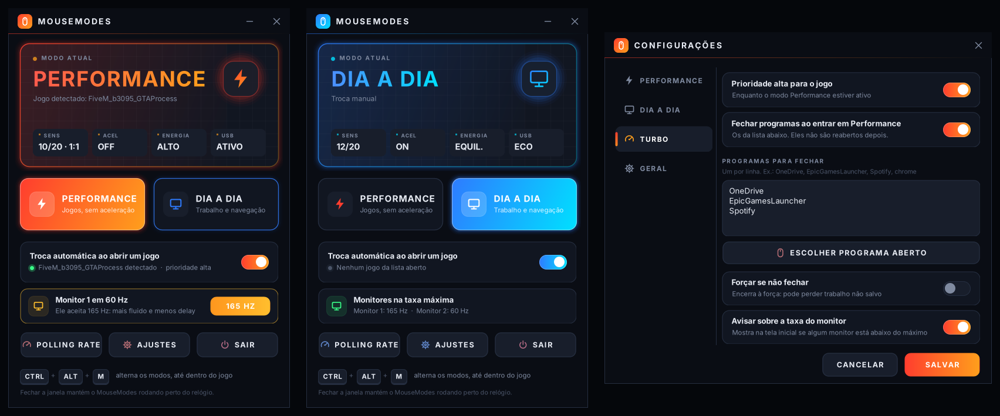

# MouseModes

[Português](README.md) · **English**

Windows 10/11 app that switches your mouse and PC between two modes: **Performance** (games) and **Daily**.
Switch from the main screen, with a global hotkey, or automatically when a game opens.

<p align="center">
  <a href="https://github.com/gabrielolvv/mousemodes/releases/latest/download/MouseModes-Setup.exe">
    
  </a>
</p>



The interface follows the Windows language: Portuguese on a Portuguese Windows, English on any other. You can pick
another one in the tray icon → Idioma / Language (it applies the next time the app opens). Every screen and the
Diagnostics log are translated.

## Install

1. Click **Download installer** above.
2. Open `MouseModes-Setup.exe` and click **Next** until the end.

The first time, Windows may show "Windows protected your PC", because the app is not digitally signed:
click **More info → Run anyway**.

To check that the installer you downloaded is the one GitHub built, compare its SHA-256 with the one on the Release
page (also in the `MouseModes-Setup.exe.sha256` file). In PowerShell, in the download folder:

```powershell
(Get-FileHash .\MouseModes-Setup.exe -Algorithm SHA256).Hash
```

- It installs only for your user, without asking for administrator rights, and adds a Start menu shortcut.
- To update, download and run the installer again: it closes the running copy and keeps your settings.
  The app shows a notice next to the clock when a new version is out (never during a game). For that it checks the
  GitHub releases page once a day, sending nothing from your PC. You can turn it off in Settings → General, or check
  right away from the tray icon → Check for a new version.
- To uninstall: Settings → Apps → Installed apps → MouseModes. Mouse and power go back to Daily mode.

## What each mode does

| | Performance (games) | Daily |
|---|---|---|
| Pointer speed | 10/20 (1:1, no multiplier) | whatever you already used |
| Acceleration ("Enhance pointer precision") | off | whatever you already used |
| Power plan | High performance or Ultimate Performance | whatever you already used ("Previous") |
| USB selective suspend | disabled (the mouse never "falls asleep") | Windows default |

Everything can be changed in **Settings**. Closing the window with the X does not quit the app: it stays in the icon
next to the clock.

Daily mode follows Windows itself: if you change the speed or acceleration in the Control Panel, that is what comes
back after Performance. When it opens, the app does not rewrite anything; it only undoes a Performance mode that was
left applied because the app was killed or the PC shut down in the middle.

### Turbo (Performance mode only)

- **High priority for the game**, restored when leaving. Some anti-cheats block it; the app then skips it and logs it
  in Diagnostics.
- **Blocks the Windows key**, only while a game from the list is in the foreground.
- **No Sticky Keys prompt** (Shift 5x and the like).
- **Silences Windows notifications.** If the app crashes while they are silenced, it restores them when it opens again.
- **Calm background** (off by default): instead of closing them, keeps the other open programs at below normal
  priority and, on Windows 11, in efficiency mode. It helps with stutters when the CPU is maxed out (browser, Steam
  downloading, OneDrive syncing). It does not touch the game, the program in the foreground (on alt-tab it goes back
  to normal), Windows processes, or voice, music, streaming, overlay, mouse software and anti-cheat (Discord, Spotify,
  OBS, NVIDIA, G HUB, Razer etc.). If the app crashes with the background calmed, it undoes it when it opens again.
- **Closes programs from your list** (e.g. OneDrive, launchers). Games from the list and Windows processes are never
  closed.

Everything goes back to normal when you leave Performance, quit the app or shut down the PC.

### More

- **Per-game profiles** (Settings → Games): speed, acceleration and power plan of their own for each game.
- **Game mouse only with the game on screen** (Settings → Performance, off by default): on alt-tab and on the
  desktop, the mouse goes back to the Daily speed and acceleration; back in the game, it uses the Performance one.
  Power, USB and Turbo do not change.
- **Automatic switch**: compares the *start* of the process name (`FiveM` matches `FiveM_b3095_GTAProcess`).
  A manual switch wins over the automatic one.
- **Find games** (Settings → Games → Find): lists the games installed through Steam and Epic, plus the open programs,
  to add several at once. The app picks the largest `.exe` in the game folder as the process, skipping uninstallers,
  launchers and anti-cheat; if it gets it wrong, you can fix the name by hand.
- **Global hotkey** (Settings → General): click the field and press the combination, with Ctrl or Alt (default:
  Ctrl+Alt+M). If another program already uses it, the app tries Ctrl+Alt+M, Ctrl+Shift+M, Ctrl+Alt+F12 and
  Ctrl+Shift+F12 and shows on the main screen which one it got.
- **Switch by command**: `MouseModes.exe --performance`, `--daily` or `--toggle` switches the mode of the running
  app, like the hotkey. Use it for a Stream Deck button, a desktop shortcut or Task Scheduler. If the app is not
  running, it opens in the tray already in that mode.
- **Monitor refresh rate**: warns if a monitor is below its maximum (e.g. 60 Hz on a 144 Hz one) and fixes it in
  one click.
- **Polling rate meter** and **double-click test** (worn switch), reading the mouse through Raw Input.
- **Aim and DPI test** (main screen or tray icon): 20 s of targets. The app measures whether you overshoot the target,
  stop short, how many corrections you make and how precise the click is, and suggests raising or lowering the DPI
  in your mouse software. Changed the DPI? Run it again: the rounds stay side by side while the app is open.
- **Sensitivity converter** (main screen → Sensitivity, or the tray icon): type your game's sensitivity and DPI and
  see the cm/360 (how far the mouse travels for a full turn) and the value that gives the same aim in CS2, Apex, TF2,
  Valorant, Overwatch 2 and Call of Duty. Changed the DPI? Enter the new one and the app recalculates each game's
  sensitivity so your aim does not change. For another game, just enter its yaw.
- **Diagnostics** (Settings → General): a log of what the app did and what failed. File at
  `%APPDATA%\MouseModes\log.txt`.
- **Windows for games** (in Diagnostics): shows Game Mode, background recording, hardware-accelerated GPU scheduling
  and, on Windows 11, optimizations for windowed games, with what usually helps. The app changes none of them: the
  "Open" button takes you to the Windows page where you decide.
- **Restore Windows defaults** (Settings → General).
- **Export and import** (Settings → General): takes games, profiles, Turbo and general settings to another PC in an
  `.xml` file. What only applies to this PC (applied mode, this PC's power plans, notification state) is left out.
  Before importing, the app shows how many games and which programs to close the file brings.

Settings are stored in `%APPDATA%\MouseModes\config.xml`.

## What really reduces delay (and what doesn't)

- **Polling rate** matters most and is set **in the mouse** (the brand's software). 1000 Hz = one report per ms;
  125 Hz = one every 8 ms. Use the meter to check it.
- **Acceleration off + speed 10** makes movement predictable. Games with *raw input* (CS2, Valorant, Apex) already
  ignore these options during a match; they apply to menus, the desktop and games without raw input.
- **Power plan** and **USB without suspend** keep the CPU and the USB port from "sleeping" and causing micro stutters.
- High FPS, the monitor at its maximum refresh rate and a wired/2.4 GHz mouse (not Bluetooth) matter more than any
  software tweak.
- The app does not apply "miracle" registry tweaks (MouseDataQueueSize, bcdedit etc.): the gain is doubtful and
  sometimes things get worse.

## Development

```
src/                 C# code (WinForms, .NET Framework 4.8)
tests/               automated tests (xUnit)
installer/           installer script (NSIS)
build.sh             builds dist/MouseModes.exe and dist/MouseModes-Setup.exe
VERSION              app and installer version
.github/workflows/   CI: build on every push and a Release on every tag
```

**Official build** (what goes to the Release), on Linux/WSL:

```sh
sudo apt-get install mono-devel nsis
./build.sh          # app + installer
./build.sh app      # app only
```

It compiles against the exact .NET 4.8 reference assemblies (`/usr/lib/mono/4.8-api`). Compiling against Mono's
standard library can produce calls that do not exist on Windows.

**On Windows** (Visual Studio, Rider or a terminal):

```powershell
dotnet build src/MouseModes.csproj -c Release
# exe at src\bin\Release\net48\MouseModes.exe
dotnet test tests/MouseModes.Tests/MouseModes.Tests.csproj -c Release
```

The tests only read Windows (mouse, registry): none of them applies mouse, power plan or USB settings. The files they
create and the log go to a temporary folder. The power plan goes through a fake applier (`ModeManager.PowerApplier`);
a new test that touches the queue must check that before queueing requests.

Texts on screen live in the code with both versions side by side: `L.T("Ajustes", "Settings")` (see `src/L.cs`).

**Publishing a version**:

1. Update the `VERSION` file (e.g. `1.2.0`) and write the `## 1.2.0` section with what changed in `CHANGELOG.md` and,
   in English, in `CHANGELOG.en.md`. Both become the Release text, and CI refuses the tag if either is missing. Commit.
2. Create and push the tag: `git tag v1.2.0 && git push origin v1.2.0`.
3. GitHub Actions builds, runs the tests, checks that the tag matches `VERSION` and attaches `MouseModes-Setup.exe`
   and `MouseModes-Setup.exe.sha256` to the Release (the SHA-256 also goes in the Release text).
   The README download button always points to the installer of the latest Release.

The CI actions are pinned by commit, with the version in a comment. Once a month Dependabot
(`.github/dependabot.yml`) checks for new versions and, if there is one, opens a PR replacing the SHA and the comment.
To update by hand, replace the SHA with the new version's (`git ls-remote --tags https://github.com/<owner>/<action>`).

Executable arguments: `--tray` (starts in the tray), `--quit` (closes the running copy, restoring everything) and
`--uninstall-cleanup` (goes back to Daily and removes "Start with Windows"), used by the installer; and
`--performance`, `--daily` and `--toggle` (switch the mode). With another copy running, the command goes to it and
the exe exits with code 0, or 1 if the running copy is from a version without these commands.
